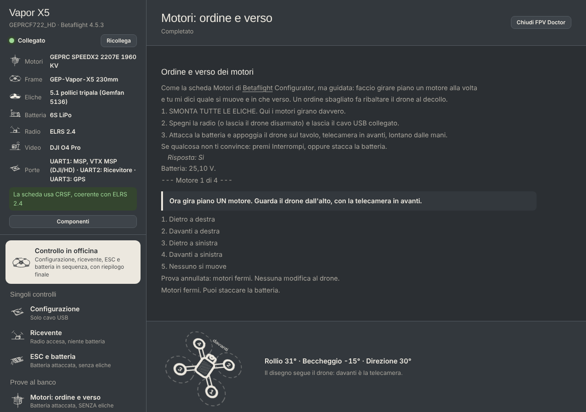

# FPV Doctor

**Il dottore del tuo drone FPV.** Colleghi il drone Betaflight con il cavo USB e FPV Doctor controlla la configurazione, ti guida nelle prove al banco, analizza i voli registrati nel blackbox e ti spiega tutto in parole semplici: *cosa ho visto, cosa significa, cosa fare*.

*English below.*

## Cosa fa

- **Controllo in officina**: tutte le prove al banco in sequenza, con riepilogo "pronto per il campo" e checklist da campo.
- **Configurazione**: legge porte, ricevente, failsafe, filtri, protocollo dei motori, batteria, OSD e segnala cosa non torna.
- **Ricevente**: stick, interruttori e modalità, controllati muovendo la radio.
- **ESC e batteria**: telemetria degli ESC e tensione, con profili per LiPo, LiHV e Li-ion.
- **Prove al banco**: ordine e verso dei motori, assetto della scheda (il disegno segue il drone), vibrazioni motore per motore.
- **Analisi del volo**: vibrazioni, motori, batteria, risposta agli stick, e confronto "prima e dopo" una modifica.
- **Correggi e migliora**: correzioni guidate, sempre con la tua conferma, una copia della configurazione prima e una doppia verifica dopo.
- **Riferimenti Betaflight**: confronto con i preset ufficiali di droni simili.

Le parole tecniche sottolineate si possono cliccare: compare una spiegazione in due righe.

## Sicurezza: leggi prima di usarla

- Le prove con i motori si fanno **solo senza eliche**. In caso di dubbio, stacca la batteria.
- L'app legge liberamente, ma **modifica il drone solo dopo la tua conferma** e salva sempre una copia della configurazione.
- I suggerimenti sono riferimenti, non regole: il pilota resta sempre responsabile del proprio drone e del proprio volo.
- Il software è fornito **così com'è, senza alcuna garanzia** (vedi la licenza).

## Installazione (Mac)

1. Installa Python 3 da [python.org](https://www.python.org/downloads/).
2. Scarica questo progetto (pulsante verde **Code → Download ZIP**) ed estrai la cartella.
3. Apri il Terminale, scrivi `python3 -m pip install pyserial numpy matplotlib` e premi Invio (solo la prima volta).
4. Scrivi `python3 ` (con lo spazio), trascina dentro il file `fpv_gui.py` e premi Invio.

Si apre la finestra di FPV Doctor e sulla Scrivania compare l'icona: dalla volta dopo basta un doppio clic.

**Per i Riferimenti Betaflight**: scarica l'archivio ufficiale dei preset da [github.com/betaflight/firmware-presets](https://github.com/betaflight/firmware-presets) (Code → Download ZIP) e mettilo, senza aprirlo, nella cartella di FPV Doctor.

Per ora è provata su Mac con Betaflight 4.5. Windows non è ancora supportato.

## Fonti

Documentazione ufficiale di Betaflight; guide di Oscar Liang (oscarliang.com); video e guide di Joshua Bardwell; manuali dei produttori di batterie (Tattu, Ovonic, Molicel) e indicazioni di CNHL e iFlight.

**FPV Doctor è un progetto indipendente: non è affiliato né approvato da nessuna delle fonti citate.**

## Licenza

GNU GPL v3: puoi usarla, studiarla, modificarla e condividerla; chi la modifica e la distribuisce deve lasciarla libera allo stesso modo.

---

# FPV Doctor (English)

**A doctor for your FPV drone.** Connect your Betaflight drone over USB: FPV Doctor checks the configuration, guides you through bench tests, analyzes blackbox flight logs and explains everything in plain words: *what I saw, what it means, what to do*. The interface is currently in Italian.

**Features:** full workshop check, configuration check, receiver test, ESC and battery test (LiPo, LiHV, Li-ion profiles), bench tests (motor order and direction, board orientation with a live 3D drawing, per-motor vibration), flight analysis with before/after comparison, guided fixes (always confirmed, with backup and double verification), comparison with official Betaflight presets.

**Safety:** motor tests only with **props removed**. The app changes settings only after your confirmation and always saves a backup first. Provided **as is, without any warranty**; the pilot is always responsible for the drone.

**Install (Mac):** install Python 3, download the ZIP, then run `python3 -m pip install pyserial numpy matplotlib` and `python3 fpv_gui.py`. A desktop icon is created for next time. Tested on macOS with Betaflight 4.5; Windows is not supported yet.

**Sources:** Betaflight documentation, Oscar Liang, Joshua Bardwell, battery manufacturers' manuals. **Independent project, not affiliated with or endorsed by any of them.**

**License:** GNU GPL v3.
